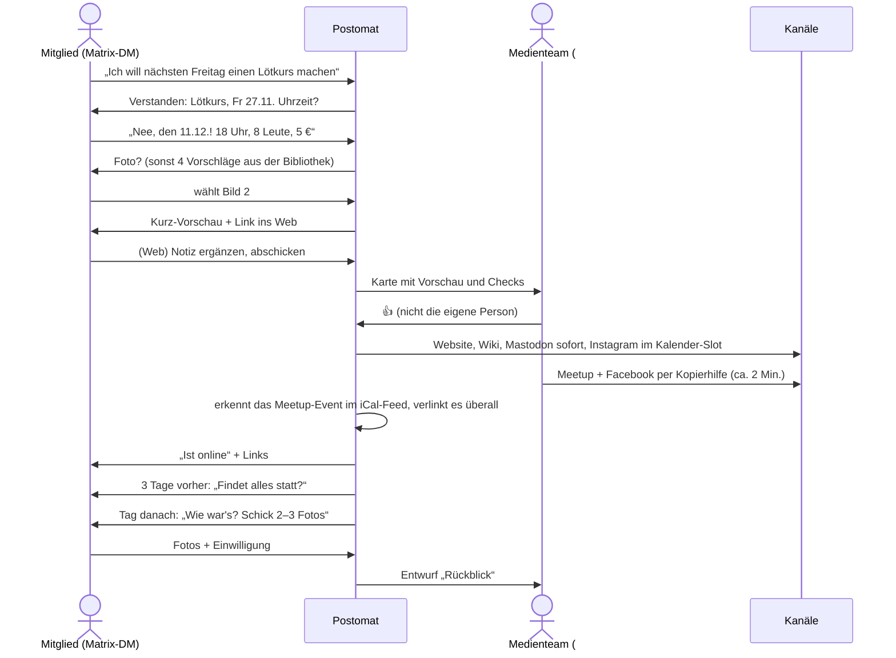
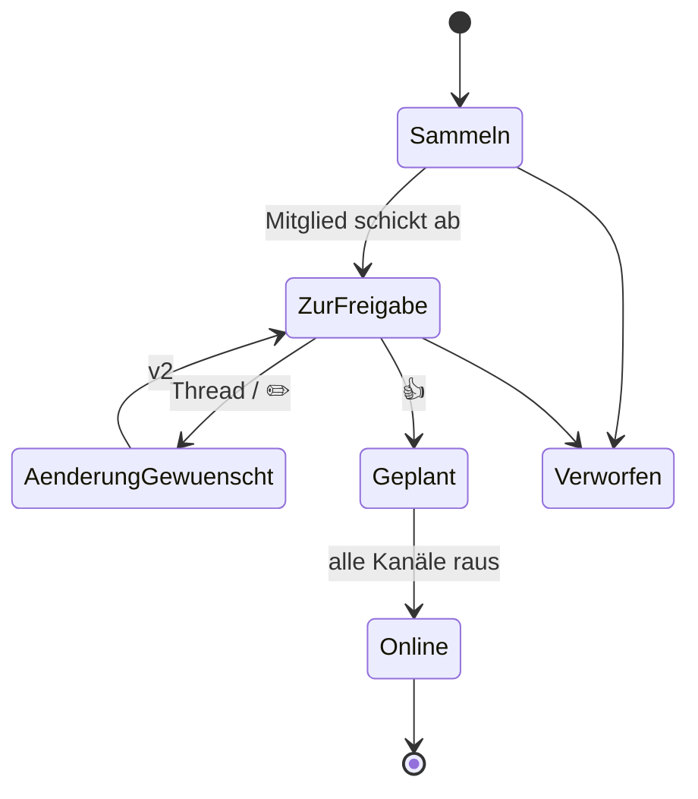

# Konzept

Der klickbare Prototyp zeigt alles hier auch visuell: [prototyp/index.html](./prototyp/index.html) (im Browser öffnen). Am besten mit dem Tab **Walkthrough** anfangen.

## Leitidee

**In Matrix wird geredet, im Web wird geschaut.** Alle fangen in einem Chat an, den sie schon kennen. Die Web-App braucht man nur, wenn etwas einen großen Bildschirm braucht: Vorschauen, Kalender, Fotobibliothek. Niemand legt ein Konto an. Der Attraktor-Login (Keycloak) und seine Gruppen entscheiden, wer was darf.

## Grundsätze

- **Ein Satz reicht.** Der Bot fragt nach, statt ein Formular zu zeigen. Pro Nachricht höchstens eine Frage. Wer mehr auf einmal schreibt, wird nicht nochmal gefragt.
- **Kein Post ohne Mensch.** Veröffentlicht wird nur nach Freigabe durch das Medienteam. Eigene Beiträge darf man nicht selbst freigeben.
- **Jeder Kanal hat einen Modus:** _Automatisch_, _Kopierhilfe_ oder _Aus_. So funktioniert Postomat auch ohne API-Zugang.
- **Zweisprachig:** jeder Text auf Deutsch und Englisch.
- **KI ist ein Helfer, keine Pflicht.** Anbieter austauschbar (extern jetzt, lokal später). Ohne KI gibt es geführte Fragen und Textvorlagen.
- **Die Schleife schließt sich:** Links zurück ans Mitglied, Erinnerung vor dem Event, Fotos danach. Damit füllt sich die Bibliothek.

## Rollen

| Rolle          | Wer                           | Keycloak-Gruppe  | Hauptort                                        |
| -------------- | ----------------------------- | ---------------- | ----------------------------------------------- |
| **Mitglied**   | alle Mitglieder               | `mitglieder`     | Matrix-DM mit `@postomat`, Web „Meine Beiträge“ |
| **Host**       | Mitglied, das ein Event macht | (wie Mitglied)   | wie Mitglied, plus Erinnerungen                 |
| **Medienteam** | 2–3 Personen                  | `medienteam`     | Matrix `#medienteam`, Web „Redaktion“           |
| **Admin**      | 1–2 Personen                  | `postomat-admin` | Web „Einstellungen“                             |

Nur Mitglieder dürfen Beiträge einreichen. Gäste fragen ein Mitglied.

## Oberflächen

| Oberfläche                | Mitglied | Medienteam | Admin | Inhalt                                                                       |
| ------------------------- | :------: | :--------: | :---: | ---------------------------------------------------------------------------- |
| Matrix-DM mit dem Bot     |    ●     |     ○      |   ○   | Einreichen, Rückfragen, Status, Erinnerungen                                 |
| Matrix `#medienteam`      |          |     ●      |   ○   | Eine Karte pro Beitrag, 👍 = frei, Thread = Änderung, Tagesüberblick         |
| Web: Beitrag ansehen      |    ●     |     ○      |       | Vorschau aller Kanäle, Notiz ans Medienteam, abschicken                      |
| Web: Meine Beiträge       |    ●     |     ○      |       | Status wie bei einer Paketverfolgung                                         |
| Web: Redaktion + Kalender |          |     ●      |   ○   | Warteschlange, Editor pro Kanal (DE/EN), Checks, Kopierhilfe, Wochenkalender |
| Web: Fotobibliothek       |    ○     |     ●      |   ●   | Suche, Einwilligungsstatus, Upload                                           |
| Web: Einstellungen        |          |     ○      |   ●   | Kanal-Modi, Freigaberegeln, Sprache, KI-Anbieter                             |

● Hauptort · ○ optional oder nur lesend

## Abläufe

### Event ankündigen (Hauptablauf)

### Weitere Abläufe

| Ablauf                 | Kurz                                                                                                                                                                                               |
| ---------------------- | -------------------------------------------------------------------------------------------------------------------------------------------------------------------------------------------------- |
| **Projekt zeigen**     | Fotos + ein Satz. Bot fragt „Was war das Kniffligste?“ und nach Einwilligung. Instagram + Mastodon.                                                                                                |
| **Änderung gewünscht** | Antwort im Thread. Medienteam ändert im Web, der Bot fragt das Mitglied nur, wenn Fakten fehlen. Karte zeigt v2.                                                                                   |
| **Nach dem Event**     | Erinnerung 3 Tage vorher („fällt aus“ → Absage-Hinweis), Fotoanfrage am Tag danach, Rückblick-Entwurf.                                                                                             |
| **Neuer Regeltermin**  | Einmal anlegen: Wiki-Seite (Serie) und Meetup-Kopierhilfe für die Meetup-Wiederholung. Danach keine Einzelposts, nur in der Monatsübersicht.                                                       |
| **Monatsübersicht**    | Am 25. liest Postomat den Meetup- und Wiki-Kalender und baut „Dezember im Attraktor / December at Attraktor“ (Instagram-Karussell, Website, Mastodon). Meldet Widersprüche zwischen den Kalendern. |
| **Niemand gibt frei**  | Nach 24 Std. erinnert der Bot die anderen namentlich. Ist das Event weniger als 5 Tage entfernt, wird der Beitrag als „eilt“ markiert.                                                             |
| **Ohne KI**            | Bot fragt die Postart mit 1️⃣–4️⃣ ab, dann feste Fragen. Texte aus Vorlagen.                                                                                                                         |

### Status eines Beitrags

Ein Beitrag hat mehrere Kanal-Posts mit eigenem Status (z. B. Website online, Instagram geplant, Meetup wartet auf Kopierhilfe). Das Mitglied sieht nur den Gesamtstatus in vier Schritten: Eingereicht → Beim Medienteam → Geplant → Online.

## Bausteine

| Baustein               | Aufgabe                                                  | Umsetzung                                                                                     |
| ---------------------- | -------------------------------------------------------- | --------------------------------------------------------------------------------------------- |
| **Matrix-Bot**         | DM-Dialog, Karten in `#medienteam`, Reaktionen auswerten | Bot-Konto auf dem eigenen Synapse. DMs sind verschlüsselt, der Bot braucht E2EE               |
| **Dialog**             | Fehlende Infos nachfragen                                | Zustandsautomat pro Beitrag, Felder je Postart                                                |
| **KI (optional)**      | Postart und Felder erkennen, Texte schreiben, übersetzen | Austauschbarer Anbieter, strukturierte Ausgabe (JSON-Schema)                                  |
| **Bild-Vorlagen**      | Banner im Attraktor-Stil aus dem Foto erzeugen           | Serverseitig gerendert, 4 Farben, siehe Styleguide                                            |
| **Fotobibliothek**     | Uploads speichern, Einwilligung, Suche                   | Dateien in Nextcloud (WebDAV), Metadaten in Postgres. Später Bildsuche (CLIP)                 |
| **Redaktionskalender** | Termine planen, Häufung vermeiden                        | Regeln, z. B. max. 1 Instagram-Post pro Tag                                                   |
| **Kanal-Adapter**      | Veröffentlichen oder Kopierhilfe anzeigen                | WordPress REST, MediaWiki API, Mastodon API, Instagram API; Meetup + Facebook als Kopierhilfe |
| **Kalender-Leser**     | Meetup- und Wiki-iCal lesen                              | Erkennt neue Meetup-Events, liefert Daten für die Monatsübersicht                             |
| **Web-App**            | Meine Beiträge, Redaktion, Bibliothek, Einstellungen     | Login über Keycloak (OIDC)                                                                    |

## Datenmodell (grob)

- **Beitrag:** Postart, Felder (Titel, Datum, Ort …), Autor (Matrix-ID / Keycloak-ID), Notiz, Status, Version
- **KanalPost:** Kanal, Modus (auto / kopieren / aus), Text DE, Text EN, Bild, geplanter Zeitpunkt, Status, Link nach Veröffentlichung
- **Serie:** Regeltermin mit Rhythmus, Wiki-Seite, Meetup-Link
- **Bild:** Datei in Nextcloud, Uploader, Tags, Einwilligung (`frei` / `Einwilligung fehlt` / `nur intern`), Bezug zu Beiträgen
- **Freigabe:** wer, wann, Ergebnis, Kommentar (Autor ≠ Freigebende)
- **Ereignis:** Verlauf pro Beitrag (eingereicht, bearbeitet, freigegeben, veröffentlicht)

## Technische Leitplanken

- Nx-Monorepo, TypeScript, pnpm
- Deployment als Docker-Images auf Coolify
- Postgres als einzige Datenbank (auch für Hintergrundjobs)
- Aufteilung: siehe [06-stufe-1.md](./06-stufe-1.md)
