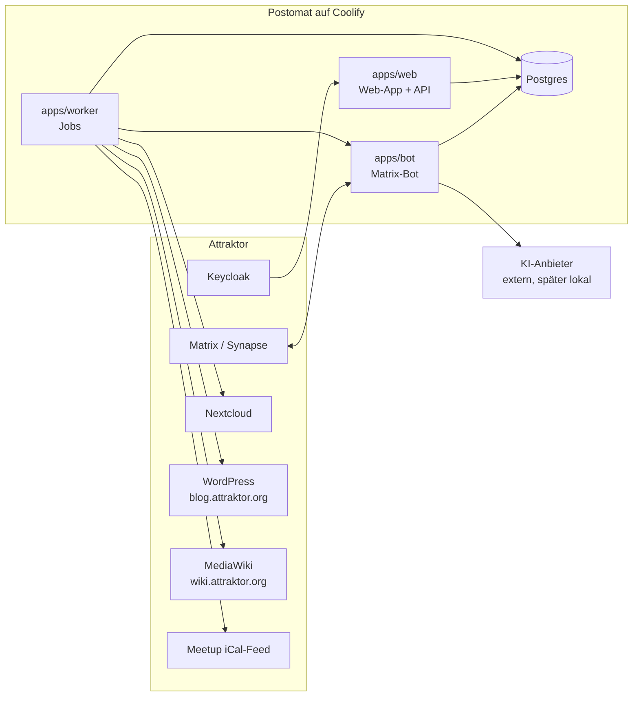

# Stufe 1: Pilot

**Ziel:** Ein Mitglied reicht per Matrix ein Event oder ein Projekt ein. Das Medienteam gibt per 👍 frei. Website und Wiki werden automatisch befüllt, die übrigen Kanäle bekommen eine Kopierhilfe. Danach vier Wochen Pilot mit 3–5 Mitgliedern.

## Umfang

| Drin                                                                       | Nicht drin (spätere Stufen)                                                           |
| -------------------------------------------------------------------------- | ------------------------------------------------------------------------------------- |
| Matrix-DM-Dialog für **Event** und **Projekt**                             | Rückblick, Vereinsnews, Regeltermine                                                  |
| Foto hochladen → Nextcloud, Einwilligungsfrage                             | Bildvorschläge aus der Bibliothek, Bildsuche                                          |
| KI (extern): Felder erkennen, Texte DE + EN schreiben; Fallback ohne KI    | Lokale KI                                                                             |
| Banner-Vorlage in 4 Farben                                                 | Weitere Vorlagen, Karussells                                                          |
| Karte in `#medienteam`, 👍 = frei, Thread = Änderung, kein Selbst-OK       | Tagesüberblick, Erinnerung bei Stillstand                                             |
| Web: Login (Keycloak), Beitrag ansehen, Redaktion mit Editor + Kopierhilfe | Kalender-Ansicht, Bibliotheks-Oberfläche, Einstellungen-Oberfläche (Konfig per Datei) |
| **Automatisch:** WordPress, Wiki                                           | Instagram-API, Mastodon, Facebook-API                                                 |
| **Kopierhilfe:** Meetup, Instagram, Facebook                               |                                                                                       |
| Meetup-Event im iCal-Feed erkennen und verlinken                           | Monatsübersicht, Abweichungen melden                                                  |
| Links zurück ans Mitglied                                                  | Erinnerung vorher, Fotoanfrage danach                                                 |

## Architektur

Die drei Apps teilen sich die Domänenlogik über Pakete. Jobs (Bild rendern, veröffentlichen, iCal lesen) laufen über eine Warteschlange in Postgres, damit es keinen weiteren Dienst gibt.

## Projekte im Monorepo

| Projekt                       | Aufgabe                                                                 |
| ----------------------------- | ----------------------------------------------------------------------- |
| `apps/bot`                    | Matrix-Client: DM-Dialog, Karten in `#medienteam`, Reaktionen, Threads  |
| `apps/web`                    | Web-App und API, Login per Keycloak                                     |
| `apps/worker`                 | Jobs: Banner rendern, veröffentlichen, iCal abfragen                    |
| `packages/core`               | Beitrag, Zustandsautomat, Freigaberegeln, Felder je Postart             |
| `packages/db`                 | Datenbankschema und Migrationen                                         |
| `packages/ai`                 | Anbieter-Schnittstelle: Felder extrahieren, Texte schreiben, übersetzen |
| `packages/templates`          | Textvorlagen pro Kanal und Postart (auch ohne KI nutzbar)               |
| `packages/render`             | Banner-Vorlage als Bild                                                 |
| `packages/media`              | Nextcloud-Zugriff (WebDAV)                                              |
| `packages/channels/wordpress` | Beitrag anlegen per REST                                                |
| `packages/channels/mediawiki` | Termin-Seite anlegen                                                    |
| `packages/channels/meetup`    | Kopierhilfe-Felder, Erkennung im iCal-Feed                              |
| `packages/channels/copy`      | Kopierhilfe für Instagram und Facebook                                  |

## Technik-Vorschlag

| Bereich   | Vorschlag                               | Warum                                                       |
| --------- | --------------------------------------- | ----------------------------------------------------------- |
| Matrix    | `matrix-bot-sdk` mit Rust-Krypto        | DMs in Element sind verschlüsselt, der Bot muss E2EE können |
| Web       | React Router (Framework-Modus) + HeroUI | Eine App für Oberfläche und API, Sessions serverseitig      |
| Login     | OIDC gegen Keycloak (`openid-client`)   | Standard, Gruppen kommen im Token mit                       |
| Datenbank | Postgres + Drizzle                      | Typsicher, einfache Migrationen                             |
| Jobs      | `pg-boss`                               | Warteschlange in Postgres, kein Redis nötig                 |
| Banner    | Satori + resvg                          | Vorlage als JSX/HTML, rendert ohne Browser                  |
| KI        | AI SDK mit austauschbarem Anbieter      | Strukturierte Ausgabe, später Ollama ohne Codeänderung      |
| Nextcloud | WebDAV-Client                           | Ordner `/Postomat-Fotos/JJJJ/...`                           |
| iCal      | `node-ical`                             | Meetup- und Wiki-Feed lesen                                 |

## Meilensteine

| #   | Meilenstein          | Fertig, wenn …                                                                                                                                                                                   |
| --- | -------------------- | ------------------------------------------------------------------------------------------------------------------------------------------------------------------------------------------------ |
| M1  | **Gerüst**           | Apps und Pakete angelegt, Postgres läuft, Deployment auf Coolify, Login per Keycloak funktioniert, Bot antwortet in einer verschlüsselten DM                                                     |
| M2  | **Einreichen**       | Ein Mitglied kann im DM ein Event oder Projekt beschreiben, wird nach Fehlendem gefragt, lädt ein Foto hoch (landet in Nextcloud) und beantwortet die Einwilligung. Funktioniert mit und ohne KI |
| M3  | **Texte und Banner** | Aus einem Beitrag entstehen Texte DE + EN für alle Kanäle und ein Banner im Attraktor-Stil                                                                                                       |
| M4  | **Freigabe**         | Karte in `#medienteam`, 👍 gibt frei (nicht der eigene Beitrag), Thread-Antwort setzt „Änderung gewünscht“, die Karte wird an Ort und Stelle aktualisiert                                        |
| M5  | **Web: Redaktion**   | Mitglied sieht seine Vorschau und schickt mit Notiz ab. Medienteam bearbeitet Texte pro Kanal und Sprache und nutzt die Kopierhilfe                                                              |
| M6  | **Veröffentlichen**  | Nach 👍 entstehen WordPress-Beitrag und Wiki-Termin automatisch. Ein in Meetup angelegtes Event wird im iCal-Feed erkannt und verlinkt. Das Mitglied bekommt die Links                           |
| M7  | **Pilot**            | 3–5 Mitglieder, 4 Wochen. Auswertung: Wie viele Beiträge? Wo brechen Leute ab? Wie lange dauert die Freigabe?                                                                                    |

M1 und die Zugänge aus [03-offene-fragen.md](./03-offene-fragen.md) (Bot-Konto, WordPress-Passwort, Wiki-Bot) hängen zusammen. Die Zugänge sollten parallel zu M1 geklärt werden.

## Risiken

| Risiko                                                     | Gegenmaßnahme                                                                |
| ---------------------------------------------------------- | ---------------------------------------------------------------------------- |
| Bot-Konto bei SSO-only-Synapse                             | Früh klären: Application Service oder Admin-API für das Konto                |
| E2EE im Bot ist fummelig (Schlüssel, Geräte-Verifizierung) | In M1 zuerst. Krypto-Speicher dauerhaft sichern                              |
| Wiki-Schreib-API ist aus oder nur per OIDC                 | Früh testen. Notfalls Bot-Passwort (`Special:BotPasswords`) oder Kopierhilfe |
| Meetup-Event wird im iCal-Feed nicht eindeutig erkannt     | Abgleich über Datum + Titel. Bei Zweifel fragt Postomat im Medienteam nach   |
| Externe KI bekommt Namen und Texte von Mitgliedern         | Nur Beitragstext senden, keine Matrix-IDs. Im Pilot transparent machen       |
| Pilot zeigt, dass Mitglieder es nicht nutzen               | Genau dafür ist der Pilot da. Vorher Walkthrough mit 2–3 Mitgliedern zeigen  |
